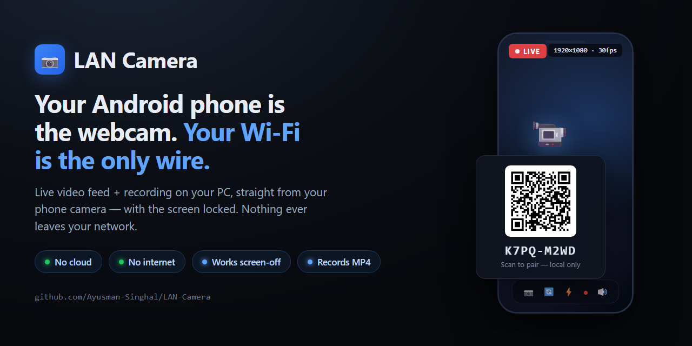

# LAN Camera

[](https://github.com/Ayusman-Singhal/LAN-Camera/actions/workflows/ci.yml)
[](LICENSE)




Use your Android phone's camera as a live, private video feed on this PC,
and record it on the PC. Works over your local network only: no internet, no
cloud, no mobile data needed. The PC side is a small Node server plus a
browser tab. The phone side is either:

- **Android app** (`android/`): keeps streaming with the phone locked and the
  screen off. Sends video + sound. Needed for recording.
- **Browser page** (Chrome, no install): fallback. Screen must stay on.

```
Android app   --- WSS: login + H.264/AAC stream --->  Node server on PC ---> viewer tab
                                                        +--> recordings/ (MP4)

Phone Chrome  --- WSS: pairing + signaling ------->  Node server on PC
      |                                               (only relays setup)
      +------- WebRTC video, encrypted, direct ------>  PC browser viewer
```

## One-time setup

1. **Install dependencies**
   ```
   npm install
   ```

2. **Open the firewall for private networks only** (admin PowerShell):
   ```
   powershell -ExecutionPolicy Bypass -File scripts\firewall.ps1
   ```
   Make sure your home Wi-Fi is set to *Private* in Windows (the script prints
   your network profiles). If Windows shows a firewall popup for Node, allow
   **Private networks only**.

3. **Install the private certificate on the phone.** The phone browser only
   allows camera access on HTTPS. This PC creates its own certificate
   authority (CA) in `data/`. It is restricted so it can only vouch for
   private IP addresses (192.168.x.x, 10.x.x.x, 172.16-31.x.x) and
   `localhost`. It cannot be used to fake real websites.

   Option A (simplest):
   ```
   npm run setup
   ```
   Scan the QR code in the terminal with the phone. The file
   `lan-camera-ca.crt` downloads. The helper stops after the download.

   Option B (safest): copy `data/ca.crt` to the phone by USB cable.

   Then on the phone:
   - Settings > Security & privacy > More security settings > Encryption &
     credentials > Install a certificate > **CA certificate** > Install
     anyway > pick `lan-camera-ca.crt`. (Menu names vary by brand. Search
     Settings for "CA certificate".)
   - Check: Encryption & credentials > Trusted credentials > **User** tab >
     "LAN Camera Private CA". Its SHA-256 fingerprint must match the one
     printed by `npm run setup`. If it does not match, delete it and use
     option B.

   Never share `data/ca.key`. If you think it leaked, delete the `data`
   folder, remove the old certificate from the phone, and repeat this step.

## Daily use

1. On the PC: `npm start`. The viewer opens at `http://127.0.0.1:8440`.
2. On the phone: scan the QR code shown in the viewer. Chrome opens the
   camera page. Tap **Start camera** and allow camera access.
3. Video appears on the PC. Change camera, resolution, FPS, quality and torch
   from either the phone or the PC.
4. On the PC viewer, click **Black screen** to save phone battery. The phone
   screen stays on but shows pure black (OLED pixels are off), and the
   preview stops rendering. Only the PC can turn it on or off. The PC
   remembers the choice and re-applies it when the phone reconnects. Tapping
   the phone screen only shows the status. If the PC is unreachable for 60
   seconds, the phone lights up again so you can see what happened. Also
   lower the phone brightness and keep it on a charger for long sessions.

**Viewer layout:** video in the middle with a control bar (camera, mic,
sound, switch camera, torch, record, mirror, rotate, fullscreen) and a side
panel with tabs: Camera, Alerts (phone notifications), Record, Pair.
Keyboard: **F** fullscreen, **C** camera on/off, **M** mirror, **O** rotate,
**S** sound, **Shift+R** record. In fullscreen the bar hides when the mouse
rests.

No QR scanner? Open `https://<pc-ip>:8443/cam` on the phone (shown under the
QR) and type the 8-character code.

## Android app (locked-screen camera + recording)

**Build the APK** (once; needs the Android SDK and a JDK 17, e.g. the one that
ships with Android Studio):
```
cd android
set JAVA_HOME=<path-to-your-JDK-17>
gradlew assembleDebug
```
(`local.properties` with your `sdk.dir` is created for you by Android Studio,
or copy `local.properties.example`.)
The APK is `android\app\build\outputs\apk\debug\app-debug.apk`. Install it
with `adb install -r app-debug.apk` (USB debugging on), or copy the file to
the phone and open it (allow "install unknown apps" for your file manager).

**Phone setup** (once):
1. The LAN Camera certificate must be installed on the phone (step 3 of
   one-time setup), unless you always pair by QR code.
2. Open the app, tap **Scan PC QR code**, and scan the QR in the PC viewer.
   The same QR works for the app and the browser page. The QR also carries
   the PC certificate's fingerprint, so the app trusts only *your* PC.
3. Tap **Allow running in background**. On Xiaomi / Redmi / POCO also set:
   App info > Battery saver > **No restrictions**, and turn on **Autostart**.
   Samsung: App info > Battery > **Unrestricted**.

**Use:**
1. On the PC: `npm start`.
2. In the app tap **Start camera** (allow camera, microphone and
   notifications). Lock the phone. A notification shows while the camera is
   in use; its **Stop** button ends it.
3. Everything else is on the PC viewer: switch camera, resolution, FPS,
   quality, orientation, torch, phone mic on/off, **Sound** (PC speakers),
   and recording.
4. To save battery, the phone camera only runs while the PC viewer is open or
   a recording is running. The app stays connected and waits otherwise.
5. **Camera: on/off** (PC viewer, Phone camera card) turns the phone camera
   off without unpairing, e.g. to save battery while you keep the viewer
   open. Click again to turn it back on, even with the phone locked.
   Starting a recording turns the camera on; turning the camera off stops
   the recording. Works for the browser page too.

**Phone notifications on the PC** (Android app only):
1. In the app, open the **Notifications on PC** card and tap **Allow
   notification access**, then switch LAN Camera on. If Android says
   "Restricted setting" (happens for apps installed from a file): App info >
   ⋮ menu > **Allow restricted settings**, then try again.
2. While the app is started (camera on or off), all your notifications show
   in the PC viewer's **Phone notifications** card: app, title, text and
   recent chat messages. The phone screen stays off. Click one to expand.
3. The **On/Off** button in that card stops the phone from sending them.
- Privacy: notifications travel only inside the encrypted connection to
  your PC, are kept in server memory only (never saved to disk, never
  logged), and are cleared when the phone disconnects. Only the viewer on
  this PC can see them. Text is always shown as plain text.

**Recording** (PC viewer > Recording > **Start recording**):
- Saved in `recordings\` next to `server.js` (button **Open folder**).
- Recording runs on the PC server: it continues even if you close the viewer
  tab. It stops when you press **Stop recording** or stop the server
  (Ctrl+C saves the file first).
- Written as MKV while recording (safe if the PC crashes), then converted to
  MP4 without re-encoding when ffmpeg is installed. Without ffmpeg the MKV
  is kept.
- Changing camera, resolution or orientation, or a phone reconnect, starts a
  new file (`..._part2`).
- The browser page cannot be recorded; use the app.

## Security model

- **Viewer only on this PC.** The viewer server listens on `127.0.0.1` only.
  Other devices on the Wi-Fi cannot connect to it at all.
- **Nothing is advertised.** No discovery broadcast. Other devices only see an
  open port 8443 if they scan for it, and get "Not found" or an auth refusal.
- **Pairing key.** A new random 128-bit key is created at every server start.
  It travels in the QR code after `#`, which browsers never send over the
  network. The phone proves it knows the key with HMAC-SHA256 challenge/
  response, so the key itself is never sent.
- **Typed code** is single-use. After 5 wrong codes it changes.
- **Brute-force block.** 5 wrong attempts from one address block it for 10
  minutes.
- **One phone at a time.** A second phone is refused while one is connected.
- **Controls on the viewer:** *Disconnect phone*, *New key* (old QR codes stop
  working and the phone is disconnected), *Lock pairing* (only the last
  paired phone may reconnect).
- **Encryption.** Page and signaling use TLS with your private CA. Browser
  video uses WebRTC DTLS-SRTP; app video travels inside the same TLS
  connection. No STUN/TURN or other outside servers are used, so nothing goes
  through the internet.
- **Certificate pinning (app).** The app accepts only a certificate signed by
  the exact CA whose fingerprint was in the QR code.
- **No casting, no discovery.** Nothing announces itself on the network:
  no mDNS/Bonjour, SSDP/UPnP, DIAL or Chromecast. The server opens no UDP
  sockets at all, and TVs or other devices that probe it get "Not found".
  The video elements disable Chrome's remote playback (Cast) option. The
  app has no cast or screen-sharing code, and uses ZXing (offline) for QR
  scanning instead of Google ML Kit, so it has no Google telemetry. Chrome's
  own "Cast…" menu on the PC only works if you click it yourself.
  Note: in browser-page mode Chrome itself announces a random
  `xxxx.local` name for the WebRTC connection (part of how Chrome
  connects; it carries no video). The Android app does not do this.
- **Cross-site protection.** WebSocket `Origin` and `Host` checks stop other
  websites open in your browser from connecting to the server.

## Limits

- **Browser page:** screen-off capture is not possible in a browser. Android
  Chrome pauses the camera when the screen locks. Use the Android app for
  that.
- **Android app:** latency is a little higher than the browser page (about
  0.1-0.3 s) because it streams over TCP. Some phone brands kill background
  apps aggressively; see the battery settings above.
- Wi-Fi networks with *client isolation* (many guest and public networks)
  block phone-to-PC traffic. Use your home network or the phone hotspot.
- The feed shows in a browser tab. It is not a virtual webcam for Zoom etc.
  (possible later via OBS Browser Source + OBS Virtual Camera).

## Phone hotspot (phase 2)

1. Turn on the phone hotspot (mobile data can be off).
2. Connect the PC to the hotspot. In Windows, set that network to *Private*.
3. The server notices the new address within 5 seconds, issues a new
   certificate, and the viewer shows a new QR code. No restart needed.
4. Scan and use as usual. Android may say the hotspot has no internet; ignore.

## Troubleshooting

- **Phone says "not secure" / camera blocked:** the CA is not installed, or
  you opened the page by a name instead of the IP in the QR code.
- **Phone page does not load:** check both devices are on the same network,
  the network is *Private* in Windows, and `scripts\firewall.ps1` was run.
- **Viewer freezes for a few seconds after opening:** Chrome on this PC takes
  several seconds the first time it starts WebRTC in a tab (GPU video codec
  check). The viewer does this right after the QR appears, so it is ready
  when the phone connects. Updating the graphics driver may make it faster.
- **Stats line** on the viewer shows resolution, FPS, bitrate, codec, round
  trip time and the network path used.
- **App says "Wrong or expired key":** the pairing key changes every time the
  PC server restarts (or you press *New key*). Scan the QR code again.
- **App says "certificate does not match":** the PC's `data` folder was
  recreated. Scan the new QR code.
- **No sound on PC:** click **Sound** in the viewer (browsers block audio
  until you click), and check **Phone mic** is on.

## Files

| Path | Purpose |
| --- | --- |
| `server.js` | Viewer server (loopback), camera server (HTTPS), auth, signaling and media relay |
| `lib/media.js` | App media packets, H.264/AAC helpers |
| `lib/mkv.js` | Matroska (MKV) writer |
| `lib/recorder.js` | Recording to `recordings/`, MP4 conversion via ffmpeg |
| `android/` | Android app (Kotlin, CameraX, MediaCodec, OkHttp) |
| `recordings/` | Saved recordings (git-ignored) |
| `setup.js` | One-time CA download helper |
| `lib/certs.js` | Private CA and server certificates |
| `lib/net.js` | LAN address detection, client address checks |
| `public/cam.*` | Phone page |
| `public/viewer.*` | PC viewer page |
| `scripts/firewall.ps1` | Windows Firewall rules |
| `data/` | CA key and certificate (secret, git-ignored) |

## Contributing

Contributions are welcome! See [CONTRIBUTING.md](CONTRIBUTING.md) for how to
report bugs, propose features and submit pull requests. For security issues,
please follow the responsible disclosure policy in
[SECURITY.md](SECURITY.md) — do not open a public issue.

## License

Released under the [MIT License](LICENSE).
